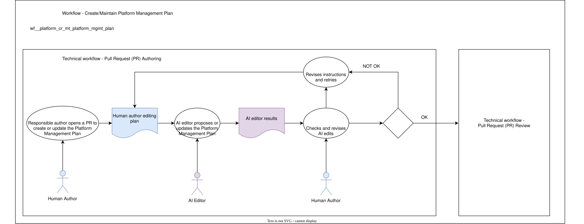

..
   # *******************************************************************************
   # Copyright (c) 2026 Contributors to the Eclipse Foundation
   #
   # See the NOTICE file(s) distributed with this work for additional
   # information regarding copyright ownership.
   #
   # This program and the accompanying materials are made available under the
   # terms of the Apache License Version 2.0 which is available at
   # https://www.apache.org/licenses/LICENSE-2.0
   #
   # SPDX-License-Identifier: Apache-2.0
   # *******************************************************************************

..
   AI Disclosure: This draft was largely AI-generated and awaits human review.
   The AI-generated portions are made available under CC0-1.0.
   SPDX-License-Identifier: Apache-2.0 AND CC0-1.0
   Assisted-by: GitHub Copilot (active model/version unavailable)

.. _technical_workflow_platform_management_plan:

Pilot: Update the Change Management Plan
========================================

The Task
--------

An audit found that the S-CORE `Change Management Plan`_ does not fully match
the current change-management process. Update the plan so a contributor can
tell how to create, analyze, implement, and close a Change Request, and who
decides at each step.

The target is ``docs/platform_management_plan/change_management.rst`` in
``eclipse-score/score``, document ``doc__platform_change_management_plan``,
which implements :need:`wp__chm_plan`.
This page records the comparison and proposed changes. The plan itself has
not been edited, and no upstream issue, PR, or human approval is claimed.

What Was Compared
-----------------

Reviewed on 15 November 2026:

* The published plan, version 3, checked against its `source at 72f142c37d`_.
* Process-description ``main`` at `1190e443a8`_, verified against the remote
  branch. The latest change-management update is the `19 October audit fix`_:
  guideline version 2 and impact-analysis template version 3.

The review covers the guideline, workflows, concept, requirements, templates,
review checklist, and work products. The related `FEP guide`_ was also checked.
FEP means Feature & Enhancement Proposal.

The plan already includes the recent scope and lifecycle clarification,
request date, impact-analysis topics, assignees, and target release.
Keep that content; this is not a complete rewrite.

Changes to Make
---------------

.. list-table::
   :header-rows: 1
   :widths: 20,35,45

   * - Plan section
     - Finding
     - Proposed change
   * - Change Request Execution
     - The plan explains feature/component changes but does not distinguish
       improvements, including process improvements.
     - State that improvements are not Change Requests, as
       :need:`gd_guidl__change_change_request` specifies. Use an improvement
       issue for this plan correction, not a feature request or FEP.
   * - Workflow and FEP Track
     - The standard route gives analysis and closure to a generic committer
       and implementation to a contributor. This does not explain the
       process's assigned responsibilities.
     - Align with :ref:`workflow_chm_requirements`: Architecture Community
       approves creation and is responsible for analysis; the Project Lead
       approves analysis. Platform Team owns feature implementation and
       closure; Delivery Team owns component implementation and closure.
       Map FEP participants to these roles without dropping required approvals.
   * - Change Request Attributes
     - The starting release is inferred from the linked PR's base commit.
       A later PR or rebase does not reliably identify the state at request
       creation.
     - Record the starting release or fixed baseline reference in the request
       when created, separately from the target release.
       See :need:`gd_req__change_attr_impact_description`.
   * - Impact analysis
     - The plan lists the current analysis topics, but says the template is
       used "if applicable". Readers could mistake this for optional analysis.
     - Distinguish required analysis content from optional use of the separate
       template. Explain where to record affected versus modified work
       products, interface responsibilities, and implementation/verification
       schedules. Use :need:`gd_temp__change_impact_analysis` and
       :need:`gd_chklst__change_cr_review`; do not add another form.
   * - Implementation and closure
     - The plan tracks linked work and checks verification, but does not name
       the responsible leads for regular status communication.
     - Add the Project Lead for feature changes and Delivery Team lead for
       component changes. Keep the existing verification checks and require
       the responsible team's closure confirmation.
       See :need:`doc_concept__change_process` and
       :need:`wf__change_close_cr`.
   * - Objectives and Scope
     - The plan does not explain the tailoring identified by the process
       guideline.
     - Add a short, project-confirmed explanation for
       :need:`gd_guidl__change_req_tailored`. Do not copy an exclusion without
       checking that its reasoning applies to S-CORE.
   * - Change Management SW Platform Work Products
     - The section says "not applicable", leaving the plan's outputs unmapped.
     - Replace it with links to the existing plan, issue records, feature/
       component request documents, and relevant decision and analysis records.
       Follow :need:`gd_temp__platform_mgmt_plan`; no new report is needed.

Clarify Template Use
--------------------

The :need:`concept <doc_concept__change_process>` and
:need:`getting-started guide <doc_getstrt__change_process>` use Decision Records
to create Change Requests. The guideline's creation instructions instead name
feature/component template content. The S-CORE plan requires Decision Records
for FEPs but makes them optional for other requests.

Ask the Process Community to clarify how these instructions fit together
before rewriting that part of the plan. Keep the existing FEP route; do not
invent a rule requiring every request to use FEP, or assume a Decision Record
is always optional. Update the linked FEP guide only if the agreed correction
affects it.

Also ask the Process Community to resolve an inconsistency in the guideline's
analysis responsibilities. The responsibility table lists the Architecture
Community as responsible for analysis and the Project Lead as approver, while
the "Analyze Change Request" prose describes the Project Lead, supported by
the Platform Team, as analyzing the request together with the Architecture
Community. Do not select one interpretation in the proposed plan correction
until the intended responsibilities are confirmed.

How Humans and AI Do the Work
-----------------------------

This is maintenance of a plan under
:need:`wf__platform_cr_mt_platform_mgmt_plan`, not a feature/component change.
The Project Lead is responsible; the Process Community approves, with support
from the Safety, Security, and Quality Managers. Human committer approval also
applies. These are the roles reviewing this plan update, distinct from the
roles for future Change Requests described inside the plan.

#. **Human author starts the work.** Open an improvement issue in
   ``eclipse-score/score`` describing the audit finding. Link this comparison
   and confirm the source revisions and required reviewers.
#. **PR Authoring.** Follow :doc:`../pr_authoring`. An AI editor may draft
   changes to the target plan from the findings above. The author checks every
   edit against the process and obtains the template-use clarification.
   Preserve the document ID, work-product link, and existing correct content.
   Update related text or diagrams only where the correction makes them
   inconsistent. Run the target repository's documentation checks.
#. **PR Review.** Follow :doc:`../pr_review`. Request human review and AI review
   of the same PR version in parallel. The human reviewer checks the whole
   change, not just AI comments. The author answers comments and corrects the
   draft; the human reviewer checks those corrections.
#. **Human approval.** The required humans approve the final changes in GitHub.
   AI cannot sign off or merge. Keep findings and decisions in the issue and
   PR; no separate pilot report is required.

   The author checks AI edits; independent PR review ends with human approval.

Ready for Review
----------------

A reader can find the request route, required information, responsible roles,
and approval points without guessing. The template-use question has a human
decision, and the plan and FEP guide do not contradict that decision.
Use :need:`gd_chklst__documentation_review` during the review. Passing a build
does not replace checking that the instructions are clear and correct.

.. _Change Management Plan: https://eclipse-score.github.io/score/main/platform_management_plan/change_management.html
.. _source at 72f142c37d: https://github.com/eclipse-score/score/blob/72f142c37d67a817d2591508e7b26492ff659fae/docs/platform_management_plan/change_management.rst
.. _1190e443a8: https://github.com/eclipse-score/process_description/tree/1190e443a88eea2fc6cd3bd64f331f7232f3615e/process/process_areas/change_management
.. _19 October audit fix: https://github.com/eclipse-score/process_description/commit/f966b10e3546a719abdd23592d863d70105bce7c
.. _FEP guide: https://eclipse-score.github.io/score/main/contribute/contribution_request/feature_request.html
