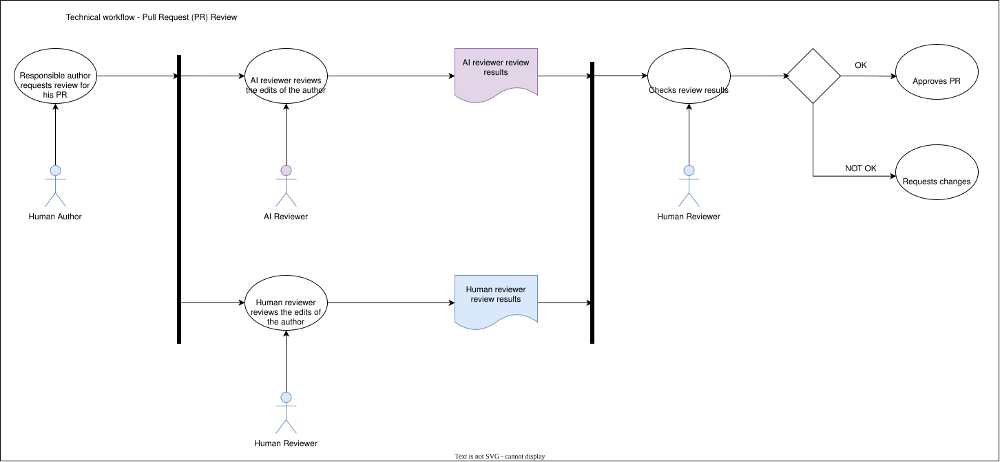

..
   # *******************************************************************************
   # Copyright (c) 2026 Contributors to the Eclipse Foundation
   #
   # See the NOTICE file(s) distributed with this work for additional
   # information regarding copyright ownership.
   #
   # This program and the accompanying materials are made available under the
   # terms of the Apache License Version 2.0 which is available at
   # https://www.apache.org/licenses/LICENSE-2.0
   #
   # SPDX-License-Identifier: Apache-2.0
   # *******************************************************************************

..
   AI Disclosure: This draft was largely AI-generated and awaits human review.
   The AI-generated portions are made available under CC0-1.0.
   SPDX-License-Identifier: Apache-2.0 AND CC0-1.0
   Assisted-by: GitHub Copilot (active model/version unavailable)

.. _technical_workflow_pr_review:

Technical Workflow: Pull Request Review
=======================================

Review a PR in GitHub. AI may review alongside a human, but the human reviewer
checks the change independently and makes the approval decision.
The :doc:`shared rules <index>` apply.

Before You Start
----------------

The author has checked the changes as described in :doc:`pr_authoring`.
The PR explains the change and links to the issue or change request.
The reviewers have access to the relevant documents, templates, and checklists.

   Human and AI reviews run in parallel. The human reviewer checks the change
   and the review comments before approving or requesting changes.

Steps
-----

#. **Request reviewers.** The author requests the required human reviewers,
   including applicable codeowners. The reviewer must be someone other than
   the author. If AI review is used, request Copilot or another permitted tool
   to review the same version of the PR.
#. **Review in parallel.** The human reviewer checks the change against the
   source material and applicable criteria, without waiting for AI results.
   AI provides additional comments. No AI findings does not mean the change
   is correct; human review still covers the full change.
#. **Address comments.** The author answers the human and AI comments, makes
   corrections, or explains why a suggestion should not be applied. The human
   reviewer checks the answers and changes.
#. **Review corrections.** After new commits, the author reruns affected checks
   and requests human re-review. Repeat AI review if needed, or make clear that
   its earlier review does not cover the new changes.
#. **Approve or request changes.** The human reviewer records the decision in
   GitHub. Blocking issues must be resolved before approval. An AI response or
   passing automated checks cannot replace human sign-off.

The PR can be merged under existing repository rules once all required human
approvals and checks are complete for the final changes. If further changes
are made, they need review too. GitHub keeps the commits, comments, checks, and
approvals; this workflow does not require a separate review report.
